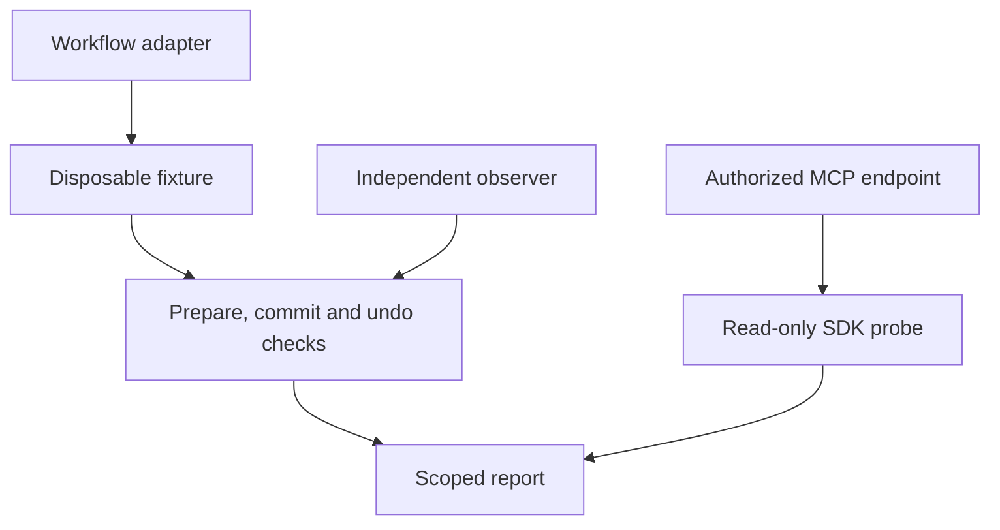

# MCP Rehearsal

**Exercise approval and recovery contracts before an MCP workflow reaches a person.**


[Quick start](#quick-start) · [Workflow checks](#workflow-checks) · [Adapter guide](docs/ADAPTERS.md) · [Example report](docs/example-report.md) · [Contributing](CONTRIBUTING.md)

MCP Rehearsal gives developers repeatable fixtures for an easy-to-miss class of workflow failures: a duplicate commit, an action prepared against stale context, or an undo that erases somebody else's later edit. Its adapter-based harness tests ten application contracts and reports the observation boundary alongside the result.

A separate, read-only probe uses the official MCP SDK to check initialization, the initialized notification, negotiated version headers and first-page tool discovery. **The probe never invokes a tool.** The workflow harness does execute configured writes and undo, so run it only against disposable fixtures or an authorized sandbox.

## Quick start

Use a Node version supported by `package.json`: `^22.22.2`, `^24.15.0` or `>=26.0.0`, with npm.

```sh
git clone https://github.com/adeelfalaksher900-creator/mcp-rehearsal.git
cd mcp-rehearsal
npm ci
npm test
npm run demo
```

The examples need no account, API key or paid service. To inspect the deliberately broken snapshot-undo adapter:

```sh
npm run demo:bug
```

A failing contract produces a nonzero exit code. This package is used from source; it has not been published to npm.

## Two inspection paths



| Path | Executes | Evidence boundary |
| --- | --- | --- |
| Workflow harness | Adapter operations, writes and undo | Adapter state, declared projections and independent observer |
| MCP probe | Initialize, initialized notification, `tools/list` | Handshake and first-page discovery only |

## Workflow checks

| Contract | What is inspected |
| --- | --- |
| Prepare without writes | Input and observer remain unchanged |
| Explicit commit approval | Recognized approval rejection, followed by a successful approved change |
| Duplicate-key replay | No additional state, observer or receipt change |
| Stale but feasible context | Old proposal rejected; a fresh proposal succeeds |
| Injected service rejection | Working baseline, classified failure and no observed change |
| Undo after unrelated addition | Added record survives |
| Undo after unrelated edit | Edited value survives |
| Undo after unrelated removal | Removed record stays absent |
| Undo a replacement | Previous owned projection restored |
| Explicit undo approval | Rejection preserves state; confirmed undo succeeds |

Positive controls reject always-error and no-op adapters. Connection, schema and timeout failures do not count as evidence of an intended approval or freshness rejection. An adapter should classify only errors it understands.

Version 0.1.1 also checks that returned state agrees with the observer after commit and undo, protects confirmed-undo input immutability and rejects non-JSON proposals. The regression fixtures use an independently observed in-memory store.

## Integrate an adapter

```js
import { rehearseWorkflow, formatMarkdown } from './src/index.mjs';
import { fixtureAdapter } from './examples/fixture.mjs';

const report = await rehearseWorkflow(fixtureAdapter(), { name: 'Inventory' });
console.log(formatMarkdown(report));
process.exitCode = report.failed ? 1 : 0;
```

Implement [the adapter contract](docs/ADAPTERS.md) to exercise another workflow. Define setup, cleanup, owned/protected projections, expected rejection categories and what the observer independently reads. Reports should stay deterministic and omit credentials and state snapshots.

For an endpoint you are authorized to inspect:

```sh
node bin/rehearse.mjs --probe https://your-server.example/mcp
```

The probe accepts HTTPS and loopback HTTP only. It rejects URLs with embedded credentials, query parameters or fragments. Programmatic callers can provide an authorized fetch wrapper; the probe does not handle account linking or OAuth onboarding. Keep credentials out of source, command arguments and reports.

## Reading a result

These are application contracts, not requirements imposed on every MCP tool. A boolean approval flag does not prove a person consented, and tool annotations do not prove behavior. The replay check exercises the same application idempotency key against advanced state.

A pure state adapter covers returned/client-applied JSON. An external sandbox needs an observer that independently reads it. The current profile does not establish distributed concurrency, same-resource edits by another actor, crash consistency, partial-write rollback, production authorization, full protocol conformance or real human interaction. A passing report is scoped evidence, not a security certification.

## Project map

| Path | Purpose |
| --- | --- |
| `src/index.mjs` | Adapter contract, workflow checks and report formatting |
| `src/probe.mjs` | Official-SDK handshake and discovery probe |
| `bin/rehearse.mjs` | Command-line entry point |
| `examples/fixture.mjs` | Working and deliberately broken inventory fixtures |
| `test/` | Workflow, returned-state and SDK probe regression tests |
| `docs/` | Adapter guide and example reports |

## Context and references

Created during the 2026 Amazon Developer Hackathon alongside the Dayweave Alexa+ simulation. Dayweave vendors this source and exercises its SDK-based handler against fictional client-carried state; its repository requires private reviewer access. MCP Rehearsal is the separate public contribution and is independent of Amazon and the MCP maintainers.

- [Official MCP Inspector](https://github.com/modelcontextprotocol/inspector)
- [MCP tools and interaction model](https://modelcontextprotocol.io/specification/2025-11-25/server/tools)
- [MCP lifecycle](https://modelcontextprotocol.io/specification/2025-11-25/basic/lifecycle)
- [Streamable HTTP transport](https://modelcontextprotocol.io/specification/2025-11-25/basic/transports)

Codex assisted development under Adeel Falak Sher's project direction. No external adoption or user-study outcome is claimed.

## Contributing and license

See [CONTRIBUTING.md](CONTRIBUTING.md). Include a minimal fictional fixture, expected and actual behavior, then run `npm ci` and `npm test`. Never post private household data, tokens or production logs.

[MIT](LICENSE). The official MCP SDK and other dependencies retain their own licenses.
